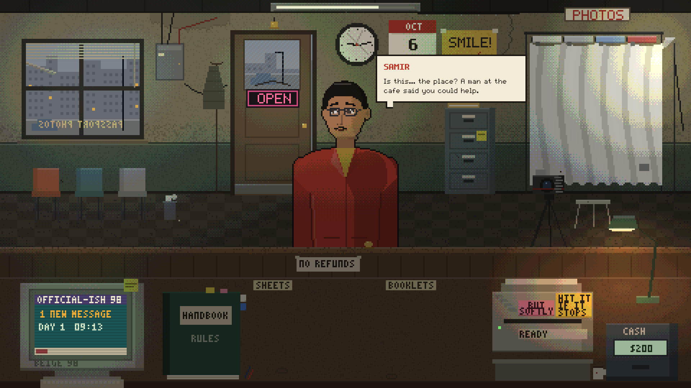
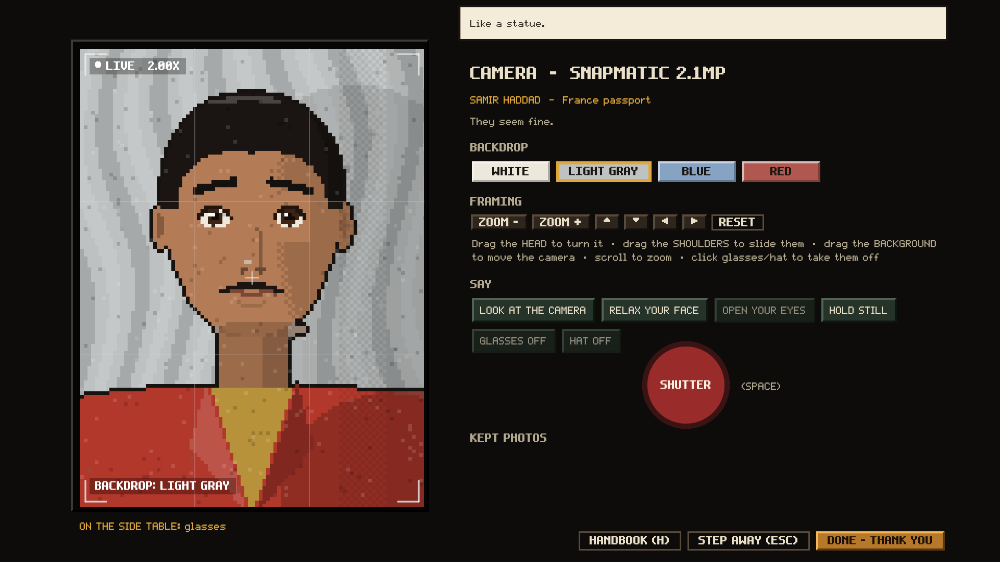
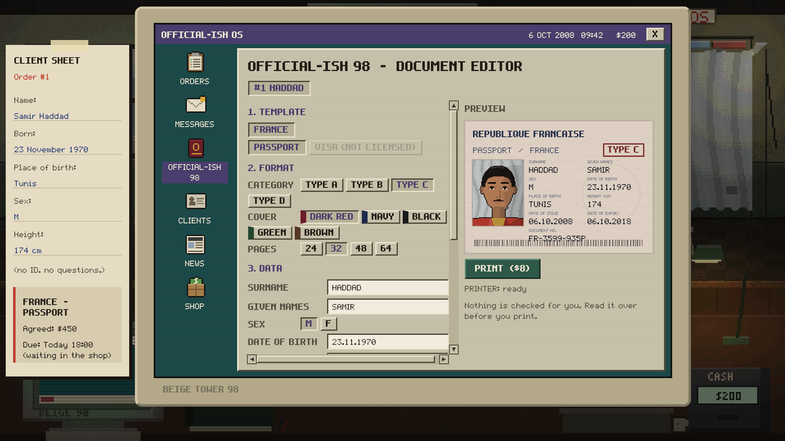
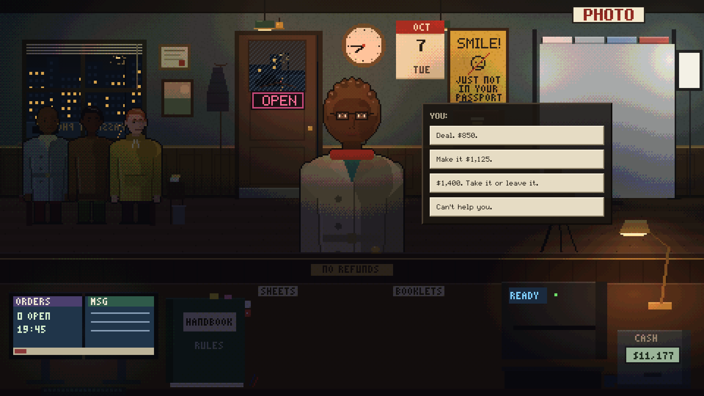

# LEGIT ENOUGH

**A single-player shop sim in lit pixel art, made in Unity 6.** You run a damp little shop that makes passports for people who can't get them the normal way:
- pose nervous customers for the photo;
- type up their papers on a 1998 computer;
- print, bind and haggle;
- hope it all holds up at the border.

Nothing has to be perfect. Just legit enough.

| | |
|---|---|
|  |  |
|  |  |

---

## Gameplay

- **Customers walk in.** Each one is modular, seeded and persistent, with 14 traits, 6 hidden stats, 12 motivations and personality-driven dialogue. A recurring story follows Samir, and later his brother.
- **Photograph them.** Pose the head (9 directions plus in-between frames) and slide the shoulders. Then deal with blinking, nervous expressions, glasses and hats, backdrops, zoom and the cheap camera's shutter lag.
- **Make the document** on the shop computer's *OFFICIAL-ISH 98*: pick the template, fill in the fields, dates and number, and place the photo. Then print it (the printer jams), bind it, check it, or shred it.
- **Get paid.** Negotiate against a hidden reservation price, juggle orders, deadlines and urgent jobs, and keep the ledger out of the red: rent, supplies, reputation tiers, heat, and risk per country.
- **Live with the outcomes.**
  - Results arrive days later through the inbox, or never.
  - A client database tracks everyone.
  - News brings risk spikes, demand surges, power cuts, a broken printer, and rule changes that leave your handbook out of date.
- **10 real countries with fictional rules**, each unlocked by tier, plus handbook purchases and equipment tiers with real mechanical effects.
- **Every day has a shape:** the morning card, the sign on the door, closing time and the end-of-day ledger.

**Status:** the full core loop and business simulation are playable.
- **A demo is built from the same code.** It runs about 15 minutes:
  - **Day 1** is a coached tutorial, with sticky notes and a pointer walking you through Samir's passport.
  - **Day 2** is scripted: rule changes, four visitors (one of them a teaser for the full game) and a guided first visit to the computer's shop.
- **36 achievements:** 15 progress, 10 skill, 4 story and 7 secret, 8 of them hidden. Twelve can be earned in the demo, and the demo banks them for the full game.
- **Four original music cues** composed in code.
- **The trailer** is also localized into Simplified Chinese, Turkish, Japanese and Korean: the same cut and music, with translated title cards. A Steam store page draft and store art exist too.
- **Not built yet:** visas, campaign milestones and endings, saving and loading, and more story arcs.

## Tech stack

| Area | What it uses |
|---|---|
| Engine | **Unity 6** (6000.0.85f1), 2D |
| Screens | One 1920×1080 stage, always shown whole and centered on a screen pixel: 1080p and 4K are exact, while 21:9, 16:10, 4:3 and the Steam Deck get plain bars |
| Editions | One codebase builds both the demo and the full game. The demo build refuses to run unless the source is set to the demo, so the full game can never ship by accident. |
| Simulation | `LegitEnough.Sim`: **pure C# with no UnityEngine references**. `GameSession` is the whole game state, and the presentation calls `Tick(dt)`, issues commands and drains events. |
| Art | A **software pixel renderer**, with everything drawn in code at 480×270 and shown at 4× through point-filtered textures. One banded light map lights the room and the people, following the clock, the weather and power cuts. |
| UI | **UI Toolkit** styled by one stylesheet, with two pixel fonts |
| Fonts | `LegitPixel` and `LegitStamp`, generated from glyph tables as TrueType by a Node script, which also writes the same tables as C# for text painted into the art. They include Latin-1 accents and the Turkish letters. |
| Audio | Sound effects synthesized in code. The music is **four original cues composed in Python** (upright bass, brushes, Rhodes, vibraphone), and a script checks the renders for loudness, peaks and seamless loops. It streams in-game as Vorbis. |
| Achievements | One catalog drives everything: a read-only tracker on the simulation, the stores (local for the demo, Steam for the full game), the unlock banners, and the badges and Steam icons, which are drawn in code |
| Testing | An offline test runner with 42 simulation tests (the full game, including a 20-day bot playthrough, and the demo), offline compile checks of the Unity layer, and a batch-mode Unity smoke test with 306 checks |
| Trailer | A Python pipeline: 60 fps takes recorded from the game, cut on a 100 BPM beat grid, with a synthesized score. Every sound the game made during a take is re-synthesized on the exact frame it happened. A `--lang` switch renders the localized versions in 1080p60 and 2160p60. |

## What I built

All of it. The game code is **`Assets/LegitEnough/Scripts/`**: 95 C# scripts, about 24k lines, plus a few editor tools.

| Area | Where |
|---|---|
| The rules: visits, customers and their personalities, dialogue, the story cast, countries, the handbook, the demo's script | `Sim/` (51 scripts): `GameSession*.cs` (including `GameSession.Demo.cs`), `Customers/`, `Content/` |
| Achievements: catalog, tracker, unlock book | `Sim/Achievements/`, `Game/Achievements/` |
| Photo scoring, document quality, negotiation, orders, the ledger, standing, inbox and outcomes, news, equipment | `Sim/Documents/`, `Sim/Business/`, `Sim/Jobs/`, `Sim/Core/` (every number in `Balance.cs`) |
| The presentation: boot, the shop, the photo station, the computer, paper handling, days, the tutorial coach, music, UI | `Game/` (44 scripts) |
| The pixel renderer: room, props, lights, fonts, logo, flags, icons | `Game/Pixel/` (`PixelBuffer`, `PixelPainter`, `RoomArt`, `ShopRenderer`, `FigurePainter`) |
| Tests, art, music and trailer tools | `Tools/SimTests/`, `Tools/ArtGen/`, `Tools/Music/`, `Tools/Trailer/` |

### Code highlights

- **`Sim/` never touches Unity.** A redesign or a full art pass can replace `Scripts/Game` without changing a single rule, and the same rules run in the offline tests and the 20-day bot playthrough.
- **`Game/Pixel/ShopRenderer.cs`:** bakes the room behind the customers and the counter in front of them. It then animates small layers on top: rain in the window, the door and bell, the clock, the screen, the printer and the cash display.
  - **`RoomArt`** swaps physical objects as you upgrade: CRT to monitors, taped inkjet to laser, bedsheet backdrop to studio.
- **`FigurePainter`:** keeps the customers' vector geometry, so photo scoring matches exactly what you see, but rasterizes it as pixels. The cheap camera gives chunkier pixels.
- **Hidden quality** (`PhotoEvaluator`, `DocumentEvaluator`): photo, information and formatting are scored with soft penalties and hard multipliers.
- **`Tools/ArtGen/fonts.js`:** plain Node with no packages. It writes both pixel fonts as TrueType outlines (one square per pixel) and the matching C# glyph tables. `build.js` renders the visual-direction concept art the same way.

## Scenes

| Scene | Purpose |
|---|---|
| `Assets/Scenes/SampleScene.unity` | Any scene works: `GameBootstrap` creates everything at runtime. |

## Integrated third-party assets

None in the game: the art, the two fonts, the UI and the sound are all generated by the project's own code. Only the trailer tool uses an outside asset: **Fusion Pixel Font** (SIL Open Font License, in `Tools/Trailer/fonts`) for the Chinese, Japanese and Korean title cards.

## Docs

- [`PROJECT_README.md`](PROJECT_README.md): the project's own notes, covering controls, the architecture, every system with its design-doc section, tuning, tests, fonts and concept art
- `Steam/store/STORE_PAGE.md`: the store page draft

## About this repository

This public repository is a **showcase**. It contains the documentation and the **151 source files I wrote** for this project. The complete Unity project, with the store-page material and the trailer, is kept in a private repository.

Copyright © Omer Avcioglu (McHunter Studio). **All rights reserved.** Viewing only; see [LICENSE](LICENSE).
